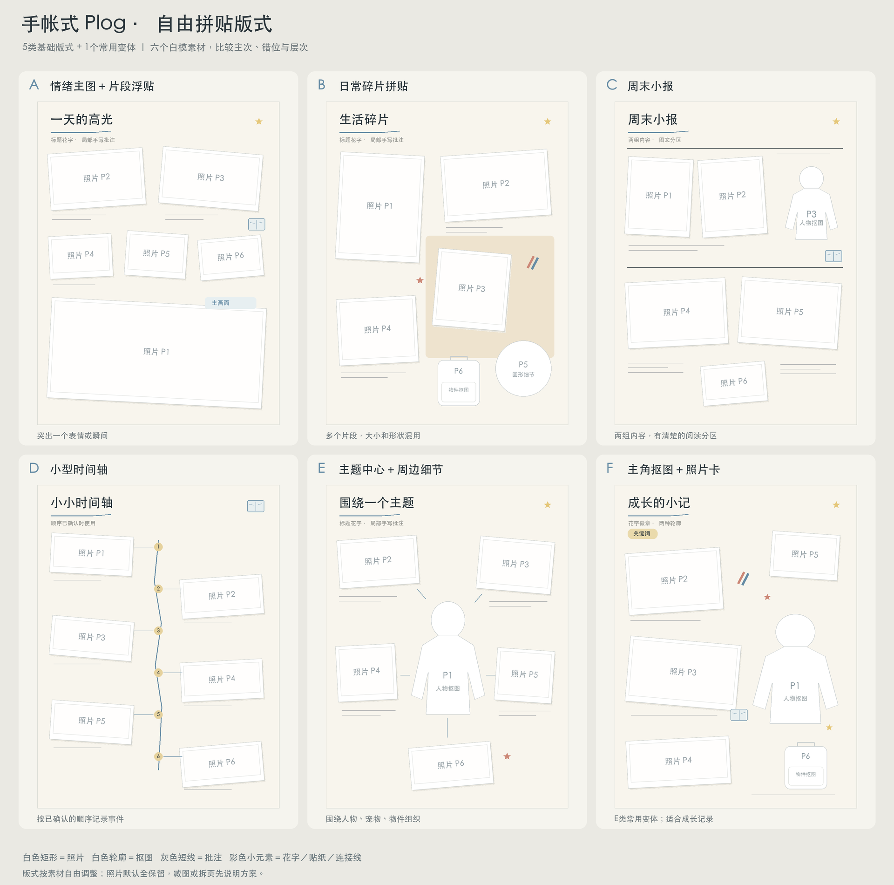

# Daily Scrapbook · 手帐式 Plog

> 给几张生活照片，再讲几句当天发生的事，让 AI 解析、整理和排成一页有温度的手账。
>
> 照片全保留 · 自由拼贴 · 人物与物件抠图 · 中文手写批注 · 花字与小贴纸

Daily Scrapbook 是一个面向支持图像输入与生成的 Codex 环境的 Skill。它会先理解照片的内容与关系，再安排主次、写短句、选择版式，最后生成可分享的手帐式 plog。

你负责提供真实生活，技能负责把它编成一页值得翻看的记录。

## 它能做什么

- 把生活随拍整理成日常手账、亲子成长记录、旅行日记、周末小报。
- 从照片中判断主图、场景、动作和物件细节，安排不同视觉权重。
- 结合用户提供的事实写简短中文批注，不凭空补时间、地点、台词或感受。
- 用完整照片、人物抠图、物件贴纸、花字和线条组织画面。
- 根据素材选择版式；也可以直接指定喜欢的类型。
- 修改已有成图的文字、照片主次和装饰，并保留旧版本。

这是一个可复用的创作流程，包含审美规则、提示词与检查方法；需要宿主实际提供图像生成能力，单独下载 Markdown 不会自动获得生图工具。

## 六种常用样式

下面用白模代替照片，比较五类基础版式和一个常用变体。**白模用于看结构，实际不按固定坐标套版。**



| 编号 | 版式 | 适合什么 | 画面重点 |
|---|---|---|---|
| **A** | 情绪主图＋片段浮贴 | 好表情、风景、活动高光 | 一张主图承接情绪，小图补细节 |
| **B** | 日常碎片拼贴 | 吃饭、出门、玩耍等生活片段 | 不同尺寸与轮廓，自然聚成图组 |
| **C** | 周末小报 | 两组主题、周末出行与餐食 | 分区清楚，照片和文字有穿插 |
| **D** | 小型时间轴 | 有明确先后顺序的事件、阶段回顾 | 少量节点与照片串起过程 |
| **E** | 主题中心＋周边细节 | 人物、宠物、穿搭、手作、物件 | 主体突出，周围细节解释主题 |
| **F** | 主角抠图＋照片卡 | 入托、生日、亲子成长节点 | 人物抠图、活动照片、物件贴纸；E的常用变体 |

白模每页统一示意六个素材，方便比较；实际图数可以不同。花字、纸色、小贴纸和描边可以跨版式搭配。

单张查看：[A](assets/layouts/a.png) · [B](assets/layouts/b.png) · [C](assets/layouts/c.png) · [D](assets/layouts/d.png) · [E](assets/layouts/e.png) · [F](assets/layouts/f.png)

## 视觉方向

画面保留轻纸感和照片的真实颜色，中文批注自然、简短。主角与细节有明显大小变化，少量花字、小贴纸和细线让纸面更有趣。

默认采用自由拼贴：照片可以轻微倾斜、上下错位、局部叠放，人物或物件可以探出相框边缘。文字沿着自然空隙安排，同时保留一两块不放文字和装饰的干净纸面。花字和贴纸集中点缀几处，留一点呼吸空间。既有松弛感，也有清楚的阅读顺序。

不会为了“自由”把所有东西随机撒满，也不会让贴纸压住脸、手或重要内容。用户明确要求整齐四格时，按用户要求制作。

## 照片与页数规则

**用户发来的照片，默认全部保留。** 用大小、裁切、图组、小卡片和抠图建立主次，不因为页面好看就自行删图。

- 建议不使用某张时，先说明具体照片、理由和替代方案；未得到明确取舍则保留。
- 建议多页时，先说明建议页数、每页分配和原因。
- 用户指定一页时，不直接改成多页；会提供一页方案和拆页建议。
- 用户已允许多页或未限定页数时，告知方案后可继续制作，避免反复确认。
- 少图不会补造照片，多图不会默默漏掉。

## 安装

### 方式一：让 Codex 安装

在 Codex 中发送：

```text
请使用 $skill-installer 安装这个仓库里的 daily-scrapbook 技能：
https://github.com/zhaopu/daily-scrapbook/tree/main/daily-scrapbook
```

### 方式二：手动安装

macOS / Linux：

```bash
git clone https://github.com/zhaopu/daily-scrapbook.git
cd daily-scrapbook
mkdir -p "$HOME/.agents/skills"

if [ -e "$HOME/.agents/skills/daily-scrapbook" ]; then
  echo "目标目录已存在，请先核对已有版本，再决定是否更新。"
else
  cp -R ./daily-scrapbook "$HOME/.agents/skills/"
fi
```

实际安装的是仓库内的 `daily-scrapbook/` 子目录。上述目录按当前 [OpenAI 官方技能文档](https://learn.chatgpt.com/docs/build-skills) 的用户级本地发现位置编写。安装方式选一种即可；如果技能未出现，可重新启动 Codex。

## 怎么用

附上照片，写出大概内容，不需要自己准备坐标和生图提示词。

### 最简单的用法

```text
使用 $daily-scrapbook，把这几张照片做成一页手帐式 plog。
大概内容：周末和朋友吃面，后来散步，遇到一只猫。
自然的手写批注，文字不要太多，照片全部保留。
```

### 指定主角抠图版式

```text
使用 $daily-scrapbook，用 F 主角抠图＋照片卡的方式。
这几张是宝宝入托第一天，妈妈陪同，开始慢慢走向独立。
照片全部保留，配一些花字、小贴纸，排版自由一点。
如果建议多页，先告诉我分配和原因。
```

### 让 AI 推荐版式

```text
使用 $daily-scrapbook，先解析这些照片，推荐一个适合的版式。
说明主图用哪张、哪些适合抠图，再直接制作。
保留所有照片；如建议多页，先说明页数和分配。
```

### 只看方案，暂不生成

```text
使用 $daily-scrapbook，先不要生图。
根据这些照片给两个版式方向，简单说明主次和文案。
```

### 局部改稿

```text
使用 $daily-scrapbook，把这张手账里的标题改成“周末碎片”，
其他照片和排版尽量保持不变。
```

更多情境见 [调用示例](examples/prompts.md)。

## 生成流程与交付

```text
照片＋几句内容
  → 逐张看图，区分已知事实和未知信息
  → 建立全图覆盖表，选择主图与版式
  → 整理短标题、局部批注和少量装饰
  → 说明照片数、页数与任何拟议取舍
  → 逐页生成，并对照原图检查
  → 保存 PNG 和页面制作记录
```

默认是铺满画布的 **3:4 竖版平面手账**。在工作区保存：

```text
output/daily-scrapbook/主题名/
├── 01-主题.png
└── page-plan.md
```

`page-plan.md` 记录照片映射、版式、最终文字、实际提示词与检查结果，方便改稿。新版本使用 `-v2` 等文件名，保留旧图与用户原文件。实际尺寸以图像工具返回值为准。

## 使用边界

- 不从照片猜测人物关系、活动先后、地点、台词和内心想法。
- 不把同一张照片的不同裁切，算成使用了多张不同来源。
- 生成式编辑可能重新渲染人脸、细节和文字，需要检查，不承诺原照像素无损。
- 用户明确要求原图不重绘或可编辑图层时，改走原图图层排版；宿主不支持就说明尚未成图。
- 默认使用宿主内置图像工具；不自动接入外部付费生图服务。
- 照片很多时，分组和适量拆页通常比挤满一页更易阅读，但先说明方案。

## 仓库结构

```text
daily-scrapbook/
├── README.md
├── LICENSE
├── NOTICE.md
├── assets/layouts/                  六类白模预览
├── examples/prompts.md              使用示例
└── daily-scrapbook/                 安装这个子目录
    ├── SKILL.md
    ├── agents/openai.yaml
    └── references/
        ├── style-dna.md
        ├── photo-story.md
        ├── composition-patterns.md
        ├── prompt-template.md
        ├── qa-checklist.md
        ├── examples.md
        ├── sources.md
        └── layout-overview.png
```

## 参考与致谢

本仓库只使用抽象白模作展示，不包含研究阶段的第三方作品图、个人实拍照片及其生成成品。详见 [NOTICE.md](NOTICE.md)。

## License

本仓库原创文档、技能规则与白模图采用 [MIT License](LICENSE)。用户照片、第三方作品以及图像工具输出的权利不由本许可证代为授予。
